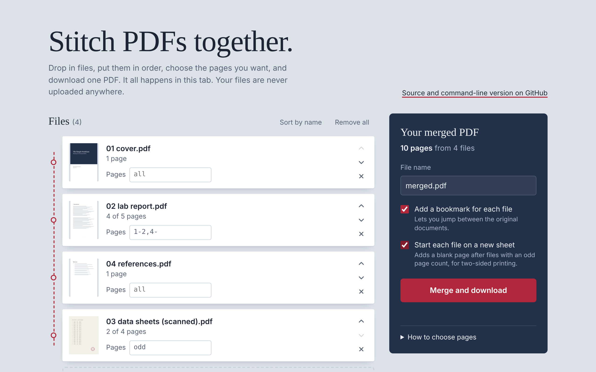
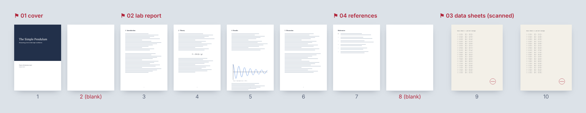
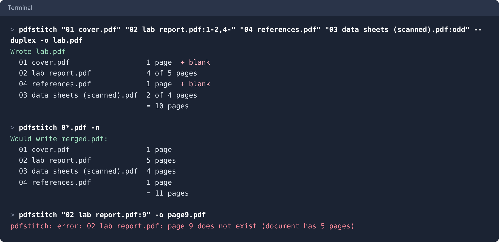

# pdfstitch

[](https://github.com/aadijewargi/pdfstitch/actions/workflows/ci.yml)
[](https://aadijewargi.github.io/pdfstitch/)
[](LICENSE)

Combine PDF files, or pick pages out of them, into one PDF. You can use it in two ways:

- **In the browser:** [aadijewargi.github.io/pdfstitch](https://aadijewargi.github.io/pdfstitch/).
  Drop files in, drag them into order, type page ranges and download the result.
  Everything runs in the tab, so your files are never uploaded.
- **From the command line:** `pdfstitch a.pdf b.pdf:2-5 -o out.pdf`. It works the same on Windows,
  macOS and Linux and adds an Explorer **Send to** entry on Windows.



The merged output from the screenshot above looks like this. Each source file gets a bookmark, and
blank pages (from the "start each file on a new sheet" option) keep every part starting on a front
side when printed two-sided:



## Why another PDF merger?

Most free online mergers upload your documents to someone's server, which is a bad idea for
transcripts, contracts or anything with your name on it. Desktop tools tend to be heavy, and plain
command-line tools trip over everyday details. pdfstitch handles these:

| Problem | What pdfstitch does |
|---|---|
| `merge *.pdf` does nothing on Windows, because cmd and PowerShell don't expand wildcards | Expands wildcards itself, in **natural order** (`scan2` before `scan10`) |
| `C:\docs\a.pdf:1-3` contains two colons | Only splits off a page range when the text after the *last* colon is a valid range and the rest isn't a drive letter |
| Re-running a merge in the same folder swallows the previous result | Folders and wildcards skip pdfstitch's own `merged.pdf` / `merged (2).pdf` |
| A typo in the last file's range leaves a half-written output | Opens and checks every input before writing, then writes to a temp file and swaps it in |
| Merged files lose their bookmarks, or the bookmarks point at the wrong page | Rebuilds the outline: one entry per file, with each file's own bookmarks nested under it and re-pointed |
| Printing two-sided puts file B on the back of file A's last page | `--duplex` pads parts with an odd page count with a blank page |
| `merged.pdf` already exists | Picks `merged (2).pdf` by default and refuses to overwrite without `--force`. It never overwrites an input. |

## Install

Requires Python 3.9 or newer.

```powershell
pip install git+https://github.com/aadijewargi/pdfstitch
# or keep it isolated:
pipx install git+https://github.com/aadijewargi/pdfstitch
```

The only dependency is [pypdf](https://github.com/py-pdf/pypdf). Encrypted PDFs that use AES need
`pip install "pdfstitch[crypto] @ git+https://github.com/aadijewargi/pdfstitch"`. Older RC4-encrypted
files work without it.

## Command-line usage



```text
pdfstitch FILE[:PAGES] ... [-o OUT] [options]

  -o, --output OUT     output file (default: merged.pdf next to the first input)
  -f, --force          replace OUT if it exists
  --sort none|name|mtime
                       keep the order given (default), natural name order, or oldest first
  --duplex             blank page after odd-length parts, for two-sided printing
  --no-bookmarks       don't add a bookmark per input file
  --no-outlines        drop the inputs' own bookmarks
  --title TEXT         PDF title metadata
  --password PW        password for encrypted inputs
  -n, --dry-run        show the plan, write nothing
  --open               open the result when done
  --install-sendto     Windows: add "Send to > PDF Stitch (merge)" to Explorer
```

Inputs can be files, folders (every PDF inside, in natural order) or wildcards. Some examples:

```powershell
pdfstitch cover.pdf report.pdf appendix.pdf -o final.pdf
pdfstitch scans\ -o scans.pdf                    # a whole folder
pdfstitch "chapter*.pdf" -o book.pdf --duplex     # wildcard, padded for duplex
pdfstitch big.pdf:1-10 -o first-ten.pdf           # one file + a range = extract pages
pdfstitch scans\*.pdf:1 -o first-pages.pdf        # a range after a wildcard applies to each file
pdfstitch backs.pdf:end-1 -o backs-fixed.pdf     # reverse a stack scanned upside down
```

### Page ranges

| Range | Pages |
|---|---|
| `5` | page 5 |
| `1-3,7` | 1, 2, 3, 7 |
| `4-` | 4 to the end |
| `7-3` | 7, 6, 5, 4, 3 (descending ranges reverse) |
| `end` | the last page, usable anywhere a number is: `end-1` reverses the whole file |
| `odd` / `even` | every other page |
| `2,2` | repeats are allowed |

Leaving the range out takes every page. Spaces around commas and dashes are fine. `1 2` is rejected
rather than quietly read as page 12.

### Windows: "Send to" menu

```powershell
pdfstitch --install-sendto
```

This puts `PDF Stitch (merge).bat` in your SendTo folder. To use it, select some PDFs in Explorer,
right-click and choose **Send to > PDF Stitch (merge)**. A `merged.pdf` appears next to them (sorted
by name, because Explorer passes the files in no particular order) and opens. If something goes
wrong, the window stays open so you can read the message. Run `pdfstitch --uninstall-sendto` to
remove the entry.

### As a library

```python
from pdfstitch import Source, merge

merge(
    [Source("cover.pdf"), Source("report.pdf", "1-2,4-"), Source("scan.pdf", "odd")],
    "out.pdf",
    duplex=True,
    title="Lab report",
)
```

## How it works

**Page ranges are parsed in two steps.** `parse()` checks the syntax without the document, so a bad
range is caught before any file is opened. `resolve(items, n)` then turns the items into 0-based
indices for an `n`-page document. Keeping the steps apart is also what lets the CLI tell `a.pdf:1-3`
from `C:\a.pdf`: it simply asks whether the text after the last colon parses. The browser version
(`docs/ranges.js`) is a line-for-line port, and both are tested against the same cases in
[`tests/range_cases.json`](tests/range_cases.json).

**Bookmarks are rebuilt, not copied.** pypdf stores an outline as a flat list in which a nested list
holds the children of the item before it. For each input, pdfstitch builds `page_map`, which maps
each source page to its first position in the merged document, and walks the source outline:

- An entry whose page was selected gets re-pointed through `page_map` and nested under the file's
  own bookmark.
- An entry whose page was left out is dropped, and its surviving children move up a level so they
  aren't lost.
- If a page is used twice, its bookmark points at the first copy.

The browser version uses pdf-lib, which has no bookmark API, so `docs/stitch.js` writes the
`/Outlines` dictionary by hand as a doubly linked list (PDF 1.7, section 12.3.3).

**Writes are atomic.** The output goes to a temporary file in the destination folder and is swapped
in with `os.replace`, so a crash or full disk never leaves a truncated file under the real name.

**Natural sort** splits names into digit and text runs. Digit runs compare as numbers and text
compares case-insensitively. Each run is tagged with its kind, so a number is never compared with a
string and the sort never raises.

**Cost.** The work is linear in the number of pages copied. Pages are copied as objects, not
re-rendered, so text stays text, nothing is recompressed and quality is unchanged. On a 2-core
cloud VM:

| Files | Pages | Time | Inputs → output |
|---:|---:|---:|---|
| 40 | 110 | 0.05 s | 0.18 MB → 0.16 MB |
| 200 | 550 | 0.25 s | 0.92 MB → 0.82 MB |
| 1000 | 2750 | 1.11 s | 4.58 MB → 4.10 MB |

You can reproduce these with `python scripts/make_demo_pdfs.py demo` (needs reportlab) and then
`python scripts/benchmark.py demo 250`.

## Testing

```powershell
pip install -e ".[test]"
python -m pytest                                   # Python: 118 tests
node --test tests/js/ranges.test.mjs tests/js/stitch.test.mjs   # browser logic: 43 tests
```

- **Pages identify themselves.** Every test PDF is built with pypdf alone, and each page has a
  distinct width. A merged result can be checked page by page just by reading the widths back.
- **Reference implementations.** 1,000 random range specs are compared with a deliberately naive
  reference implementation. Random multi-file merges are compared page by page with the expected
  sequence.
- **Edge cases** covered by the tests: encrypted inputs (no password, wrong password, right
  password), corrupt and missing files, an output that is also an input, an existing output, a
  missing output folder, duplicate pages, bookmarks for dropped pages, duplex padding (never after
  the last part), Windows drive-letter paths, CRLF line endings in the Send To script, and unicode
  bookmark titles in the browser version.
- **CI** runs on Windows, macOS and Linux with Python 3.9 and 3.13, plus the Node tests.

## Web app

The app is the static site in [`docs/`](docs). pdf-lib and pdf.js are vendored in `docs/vendor`, and
the page uses system fonts, so it makes no third-party requests at all. To run it locally:

```powershell
cd docs
python -m http.server 8000   # then open http://localhost:8000
```

The command-line version can do two things the browser version can't: open password-protected
files, and keep the inputs' own bookmarks.

## Roadmap

- `--interleave` for re-collating fronts/backs scans
- Rotate pages (`3r90`) and scale mixed page sizes to one size
- Page thumbnails in the web app, so you can pick pages by clicking instead of typing ranges
- Split mode (`pdfstitch split big.pdf --every 10`)

## License

[MIT](LICENSE). The vendored [pdf-lib](https://github.com/Hopding/pdf-lib) is MIT-licensed and
[pdf.js](https://github.com/mozilla/pdf.js) is Apache-2.0. Their licenses are in `docs/vendor/`.
